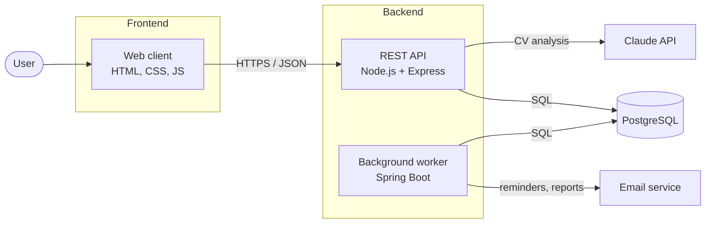

# Alnitak

Job application tracker with AI-powered CV-to-offer matching.

Named after the star in Orion's Belt, one of the first references used to navigate the night sky.

## Status

In development. Phase 1 (foundation) complete; next: authentication.

## Tech stack

- **API:** Node.js, Express
- **Database:** PostgreSQL
- **Background worker:** Java, Spring Boot
- **AI:** Claude API
- **Frontend:** HTML, CSS, JavaScript

## Architecture



The API handles authentication, applications and AI analysis. The worker runs scheduled jobs (reminders and weekly reports) and shares the same database, so it needs no API of its own. Currently implemented: REST API and PostgreSQL.

## Project structure

```
alnitak/
├── api/                 Node.js + Express REST API
│   ├── src/
│   │   ├── config/      Environment and app configuration
│   │   ├── routes/      Endpoint definitions
│   │   ├── controllers/ Request handling
│   │   ├── services/    Business logic and external APIs
│   │   ├── middlewares/ Auth, validation, error handling
│   │   └── db/          Connection and migrations
│   └── tests/
├── worker/              Spring Boot service for reminders and reports
├── frontend/            Web client
└── docs/                Diagrams and technical documentation
```
## Local setup

### Database

Requires PostgreSQL. Create a dedicated user and database:

```sql
CREATE ROLE alnitak_app WITH LOGIN PASSWORD 'your_password';
CREATE DATABASE alnitak OWNER alnitak_app;
```

See [docs/database.md](docs/database.md) for the schema diagram and constraints.

### API

```bash
cd api
cp .env.example .env   # then fill in DATABASE_URL
npm install
npm run dev
```

Health check: `GET http://localhost:3000/health`

## Challenges

Real problems found while building the project and how they were solved.

- **WSL could not reach PostgreSQL on Windows.** The API failed with `Connection refused`. `ip -4 addr` showed a `172.x` address: WSL was in NAT mode, so `localhost` did not point to Windows. Switching WSL to mirrored networking fixed it, verified with `psql` before touching any code.
- **A silent typo broke the database connection.** `/health` reported the database as unreachable while PostgreSQL was running. Logging the real error revealed `client password must be a string`. Tracing the value step by step (environment config, then the pool options) found a misspelled property: JavaScript returned `undefined` without any error, and the driver fell back to default credentials. The error logging stayed in place permanently.
- **The wrong Node.js runtime.** `npm run dev` looked for `C:\Windows\src\server.js`: WSL was using the Windows Node.js inherited through the `PATH`. Installing Node.js inside Linux with nvm fixed it.
- **Windows line endings.** Files edited in Windows mode were committed with CRLF. A `.gitattributes` rule plus `git add --renormalize` normalized the whole repository to LF and prevents it from happening again.

See [docs/decisions.md](docs/decisions.md) for the technical decisions behind the project.

## License

MIT
