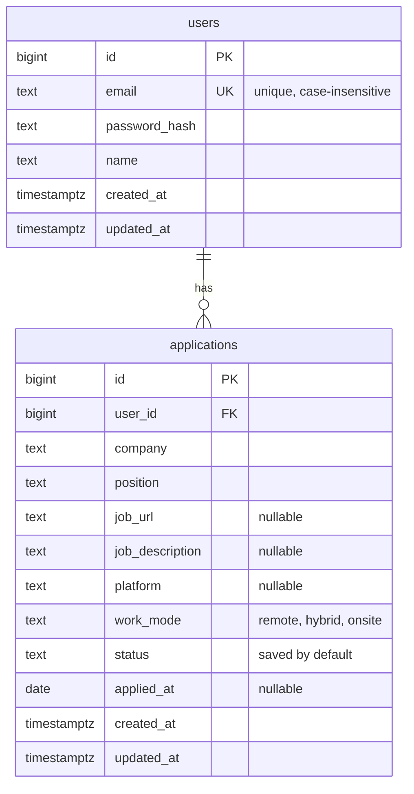

# Database

PostgreSQL schema, managed with versioned SQL migrations in `api/src/db/migrations`.



## Constraints and indexes

| Table | Name | Purpose |
| --- | --- | --- |
| users | `users_email_lower_idx` | Unique index on `lower(email)`: prevents duplicate accounts that differ only in letter case |
| applications | `user_id` foreign key | `ON DELETE CASCADE`: deleting a user removes their applications |
| applications | `status` check | Allowed values: `saved`, `applied`, `technical_test`, `interview`, `offer`, `rejected`, `withdrawn` |
| applications | `work_mode` check | Allowed values: `remote`, `hybrid`, `onsite` |
| applications | `applications_user_id_status_idx` | Speeds up the most common query: a user's applications filtered by status |

## Running migrations

```bash
cd api
npm run migrate -- up      # apply pending migrations
npm run migrate -- down    # revert the last migration
```

Any schema change must include an update to this document in the same pull request.